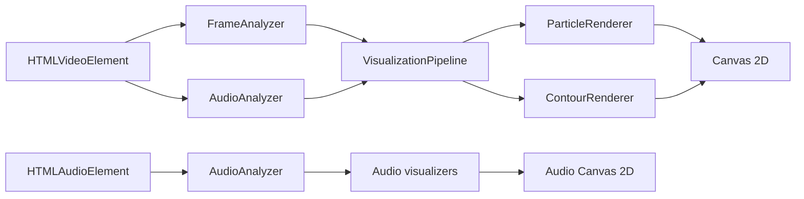

# FluxGraph Studio

<div align="center">
<strong>Turn media into motion.</strong>
<p>A browser-based studio for transforming video and audio into responsive visual art.</p>
<p>
  
  
  
  <a href="LICENSE"></a>
</p>
<p>
  🚀 <a href="https://fluxgraph.vercel.app/" target="_blank" rel="noopener"></a>
  🌐 <a href="https://tlongzuize.github.io/FluxGraph-Studio/" target="_blank" rel="noopener"></a>
</p>
</div>

FluxGraph Studio analyzes locally selected media in your browser and renders it through a real-time Canvas 2D pipeline. Video and audio stay on your device; the app does not upload media to a server.

**Current version:** [v0.1.0-alpha.1](https://github.com/TLongzuize/FluxGraph-Studio/releases/tag/v0.1.0-alpha.1) · Pre-release

## Highlights

### Video visualization

- **Particles** reconstruct video silhouettes with stable placement, adjustable density, glow, trails, and audio response.
- **Contours** extract outlines with Marching Squares, then refine them with path simplification and smoothing.
- **Video audio reactivity** analyzes bass, midrange, treble, and overall energy to animate particle and contour parameters.
- **Quality profiles** tune analysis resolution, renderer detail, and canvas pixel ratio. The default profile is Balanced.

### Audio visualization

Load a local audio file by choosing it or dropping it into the audio workspace. Playback, analysis, and visualization use the same browser-decoded audio source.

- **Spectrum Bars** visualizes frequency-bin energy.
- **Waveform** draws the time-domain signal.
- **Radial Spectrum** maps frequency energy around a circle.
- **XY Math Motion** offers waveform delay embedding and audio-reactive parametric curves with a live equation readout.

### Export

- **PNG** downloads the current rendered frame.
- **WebM** records the rendered canvas and available source audio.
- **MP4** converts the WebM recording to H.264/AAC in the browser using the locally hosted FFmpeg WebAssembly core. Conversion progress is shown while encoding. Export time depends on video duration, resolution, and device speed.

The export pipeline starts video exports from the beginning and uses the active visualization mode and settings.

## Quality profiles

| Profile | Analysis resolution | Particle density | Canvas DPR cap |
| :--- | ---: | ---: | ---: |
| Speed | 160 × 120 | 0.30 | 1.00× |
| Balanced | 320 × 240 | 0.60 | 1.25× |
| Quality | 480 × 360 | 1.00 | 1.50× |
| Ultra | 640 × 480 | 1.00 | 1.75× |
| Max | 800 × 600 | 1.00 | 2.00× |

Higher profiles increase analysis detail and GPU/memory use. Max is bounded to an 800 × 600 analysis mask and the main canvas has a pixel budget to limit memory use. The effective canvas ratio may be lower than the profile cap on constrained displays.

## Architecture

The video rendering loop runs outside React's render cycle. It uses `requestVideoFrameCallback` where available, with a `requestAnimationFrame` fallback.



The video element is the playback timeline. Frame analysis produces a binary mask for the selected renderer, while audio analysis supplies live frequency metrics. The separate audio workspace uses an `HTMLAudioElement` and Canvas visualizers without routing audio through the video pipeline.

## Keyboard shortcuts

| Key | Action |
| :--- | :--- |
| <kbd>Space</kbd> | Play or pause video |
| <kbd>←</kbd> / <kbd>→</kbd> | Seek by 5 seconds |
| <kbd>↑</kbd> / <kbd>↓</kbd> | Adjust volume |
| <kbd>M</kbd> | Toggle mute |
| <kbd>F</kbd> | Toggle fullscreen |
| <kbd>1</kbd> / <kbd>2</kbd> | Select Particles / Contours |
| <kbd>S</kbd> | Toggle Visual Parameters |
| <kbd>?</kbd> | Open keyboard shortcuts |
| <kbd>Esc</kbd> | Close a drawer or modal; exit fullscreen |

Video shortcuts are inactive while the audio workspace is selected. Text and range inputs retain their normal keyboard behavior.

## Live Demo

Try FluxGraph Studio right in your browser — no install required:

| Platform | URL |
| :--- | :--- |
| **Vercel** | <a href="https://fluxgraph.vercel.app/" target="_blank" rel="noopener">https://fluxgraph.vercel.app/</a> |
| **GitHub Pages** | <a href="https://tlongzuize.github.io/FluxGraph-Studio/" target="_blank" rel="noopener">https://tlongzuize.github.io/FluxGraph-Studio/</a> |

Both deployments are updated automatically when `main` is pushed.

## Get started

### Requirements

- Node.js 20 LTS or newer
- npm
- A modern browser with Canvas 2D, Web Audio, and media playback support

### Install and run

```bash
git clone https://github.com/TLongzuize/FluxGraph-Studio.git
cd FluxGraph-Studio
npm ci
npm run dev
```

Open the local URL printed by Vite. With the current Vite base configuration, it is `http://localhost:5173/FluxGraph-Studio/`.

### Project scripts

| Command | Purpose |
| :--- | :--- |
| `npm run dev` | Start the Vite development server with hot reload |
| `npm run test` | Run the Vitest suite once |
| `npm run lint` | Run Oxlint |
| `npm run build` | Type-check and create the production bundle in `dist/` |
| `npm run preview` | Serve the production bundle locally |

## GitHub Pages

The project includes a GitHub Actions workflow that runs `npm ci`, tests, and a production build when `main` is updated, then deploys `dist/` to GitHub Pages. Set the repository's Pages source to **GitHub Actions**.

Vite is configured with the `/FluxGraph-Studio/` project-page base path so bundled scripts, styles, and FFmpeg assets resolve correctly when served from GitHub Pages.

## Privacy and compatibility

- Video, audio, frame capture, and MP4 conversion are processed locally in the browser.
- Supported media formats depend on the browser's installed codecs. MP4, WebM, OGV, and MOV are offered for video; audio support depends on the browser.
- MP4 conversion uses CPU and memory. Longer or higher-resolution recordings take longer to encode and require more memory.

### Media Credits

The "Bad Apple!!" media file used in this repository for testing and demonstration purposes belongs to its respective creators:
* **Original Composition:** ZUN (Team Shanghai Alice) — *Touhou 4: Lotus Land Story*
* **Remix & Arrangement:** Masayoshi Minoshima (Alstroemeria Records)
* **Vocals:** nomico
* **Shadow Art / Video:** Anira (あにら)

*This asset is used under the Touhou Project Derivative Work Guidelines for non-commercial, open-source educational use.*

## License

FluxGraph Studio is available under the [MIT License](LICENSE).
